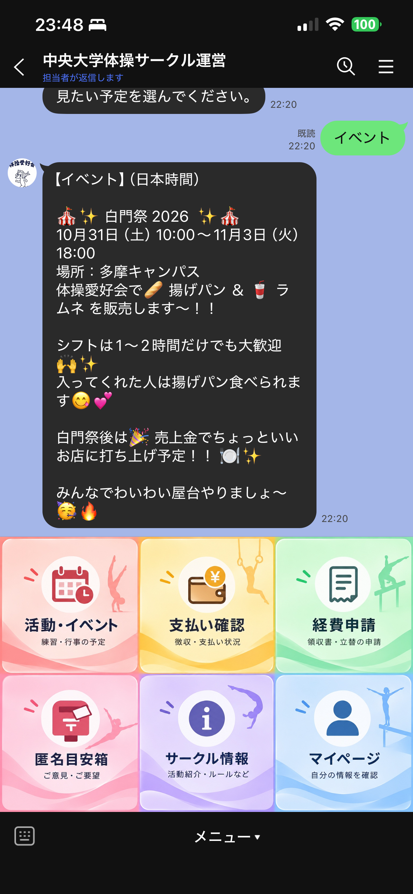
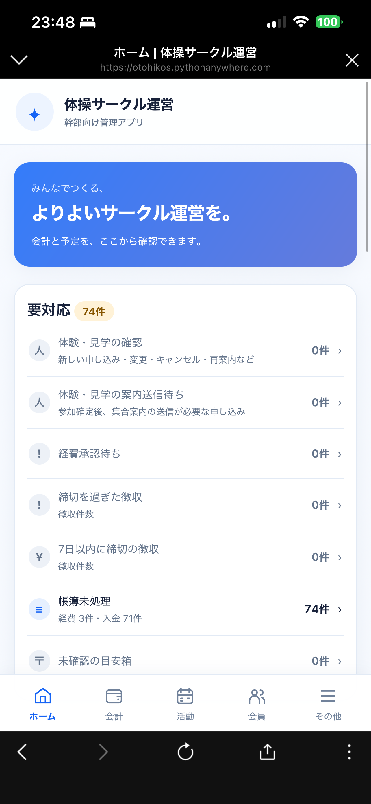
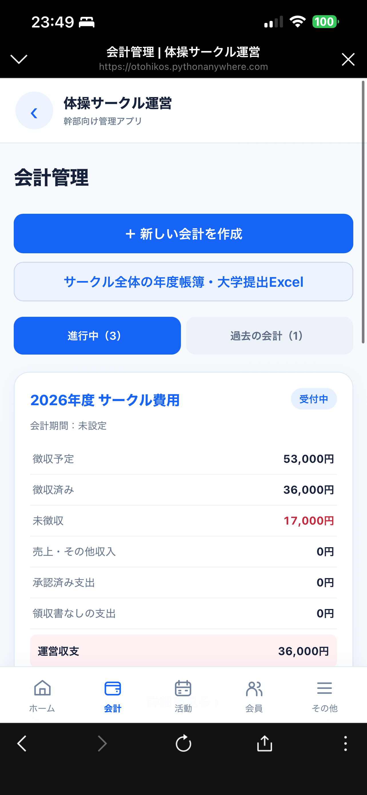
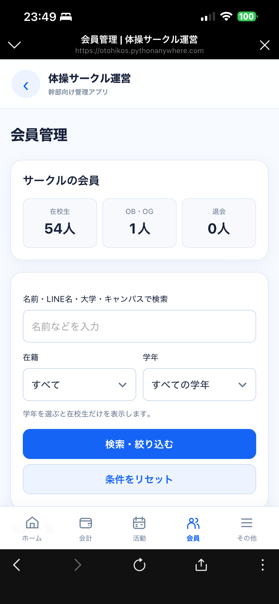

# Circle Bot Portfolio

大学の体操サークルの運営負担を減らすために開発した、**LINE公式アカウント連携型のサークル運営管理システム**のポートフォリオ版です。

> 本番環境で使用しているリポジトリは非公開です。  
> このリポジトリでは、個人情報・本番URL・秘密情報・運用上センシティブな実装を除き、設計思想と代表的な実装例を公開しています。

## Screenshots

実際の運用画面です。一般会員はLINEから操作し、幹部はWeb管理画面から会計・会員・活動などを管理します。

<table>
  <tr>
    <td align="center"><strong>LINEメニュー</strong></td>
    <td align="center"><strong>管理画面ホーム</strong></td>
  </tr>
  <tr>
    <td></td>
    <td></td>
  </tr>
  <tr>
    <td align="center"><strong>会計管理</strong></td>
    <td align="center"><strong>会員管理</strong></td>
  </tr>
  <tr>
    <td></td>
    <td></td>
  </tr>
</table>

## What I built

一般会員は普段使っているLINEから操作し、幹部はWeb管理画面から会員・会計・経費・徴収・活動予定などを管理できます。

### 一般会員向け
- 会員登録
- マイページ
- 支払い状況の確認
- 経費申請・領収書送信
- 活動予定の確認
- 匿名目安箱
- サークル情報の確認

### 幹部向け
- 会員管理・検索
- 経費申請の承認 / 却下
- 徴収・支払い状況管理
- 会計ごとの収支管理
- 活動・イベント管理
- LINEお知らせ作成
- 匿名目安箱の確認
- 年度更新

## Why I built it

幹部になった際、前年度の幹部へヒアリングしたところ、特に

- 経費・領収書管理
- 徴収・支払い確認
- 会計情報の整理
- 活動予定の共有

に負担が集中していました。

そこで、**利用者に新しい行動を求めないこと**を重視し、サークル全員が普段使っているLINEを入口にしました。

## Architecture

```text
LINE Official Account
        ↓
LINE Messaging API / Webhook
        ↓
   Python / Flask
        ↓
      SQLite
        ↓
LINE reply / Admin Web UI
```

詳細は [docs/ARCHITECTURE.md](docs/ARCHITECTURE.md) にまとめています。

## Tech Stack

| Category | Technology |
| --- | --- |
| Backend | Python / Flask |
| Database | SQLite |
| Frontend | HTML / CSS |
| API | LINE Messaging API |
| Hosting | PythonAnywhere |
| Security | Flask-WTF / CSRFProtect / signed token / session |
| Development | Git / GitHub / GitHub Actions |
| AI-assisted development | ChatGPT / Codex |

## Representative implementation

本番コードそのものではなく、実際に採用している設計を簡略化したサンプルを公開しています。これらは設計説明用の抜粋であり、このPublicリポジトリ単体で本番システムを再現・デプロイすることを目的としていません。

- [Webhook signature verification](examples/webhook.py)
- [Admin authentication](examples/auth.py)
- [Relational data model](examples/database.py)
- [SQLite backup](examples/backup.py)

## Security / Operations

本番では以下を意識して実装しています。

- LINE Webhook署名検証
- admin権限確認
- 署名付きログイントークン
- Flask sessionによる認証状態管理
- CSRF対策
- HttpOnly / SameSite / Secure Cookie
- Secretの環境変数管理
- DBバックアップと整合性確認

「安全だと言い切る」のではなく、実運用上のリスクを前提に継続的に改善しています。

## Product decisions

### LINEを入口にした理由
既存の運営連絡がLINE中心だったため、新しいアプリを覚えてもらうより、既存行動の中に機能を組み込む方が利用されやすいと考えました。

### 会計担当への集中を減らした
以前は会計担当が領収書を受け取り、内容を整理して記録していました。

現在は申請者本人がLINEから必要事項を入力し、幹部は管理画面で確認・承認します。  
**入力作業を申請者側へ分散し、幹部を「入力する人」から「判断する人」に変える**ことを狙いました。

### 機能追加を一度止めた
開発途中で機能を追加しすぎ、UIが複雑になった時期がありました。

そこで、
- 誰が使うのか
- 何のために使うのか
- 本当に必要か

を再整理し、実際の利用者からのフィードバックを優先する方針に切り替えました。

## AI usage

ChatGPTやCodexは、

- 実装方法の検討
- コード生成・修正
- UI改善案
- エラー調査
- 設計レビュー

に活用しています。

一方で、課題選定・ヒアリング・機能の優先順位・UI/運用フロー・実運用・改善判断は自分で行っています。

AIを「代わりに考えるもの」ではなく、**開発速度を上げるための支援ツール**として使っています。

## Testing

現在は主要機能について手動回帰テストを行っています。  
確認項目は [docs/TEST_CHECKLIST.md](docs/TEST_CHECKLIST.md) にまとめています。

## Repository structure

```text
circle-bot-portfolio/
├── README.md
├── .env.example
├── requirements.txt
├── examples/
│   ├── webhook.py
│   ├── auth.py
│   ├── database.py
│   └── backup.py
└── docs/
    ├── ARCHITECTURE.md
    └── TEST_CHECKLIST.md
```

## Current status

**In use / continuously improving**

本番システムは実際のサークル運営で使用しながら改善しています。
